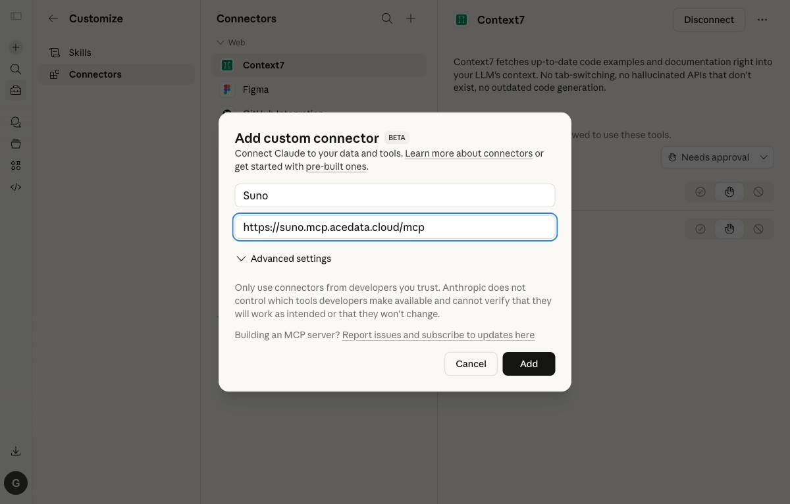

# GPT Image by Ace Data Cloud

[English](../README.md) · 版本 0.1.0

这是 Ace Data Cloud 提供的 **GPT Image image服务独立插件**，不是 GPT Image 模型厂商或 Anthropic 官方插件。仅复用现有 MCP，不改变 Claude 的聊天模型；付费请求按 Ace Credits 计费。

## 1. 安装入口

源 PR 合并后，在 Claude Code 中执行：

```text
/plugin marketplace add AceDataCloud/Skills
/plugin install gpt-image-by-ace-data-cloud@acedatacloud-skills
```

在已添加市场的 `/plugin` → Discover 搜 **GPT Image** 或 **gpt-image-by-ace-data-cloud**。这是 **Ace 自有 marketplace 的原生插件安装**，不是 Anthropic 官方目录已收录。当前改动尚未合并发布，合并前只能用 PR 本地 checkout 验证；不能把本地安装算成官方上架。旧媒体合集仍可选，不需要安装全套；避免同时启用重复服务。

真实验证版本是 Claude Code 2.1.81，不代表最新。若没有 **Configure options**，先从官方渠道更新客户端；Token 对话框和付费首调另行验收。

## 2. 登录 Ace 并获取专用 Token

1. [注册或登录 Ace Data Cloud](https://platform.acedata.cloud/?utm_source=github&utm_medium=referral&utm_campaign=evergreen&utm_content=gpt_image_claude_signup)，打开 [Applications 应用列表](https://platform.acedata.cloud/console/applications?utm_source=github&utm_medium=referral&utm_campaign=evergreen&utm_content=gpt_image_claude_api_key)，选择 **General application 通用应用**；没有时先初始化。
2. 检查 **GPT Image** 权限、余额和 [当前价格](https://platform.acedata.cloud/documents/openai?utm_source=github&utm_medium=referral&utm_campaign=evergreen&utm_content=gpt_image_claude_pricing)。在应用卡片复制 Key，或 **Manage Keys / 管理密钥 → Create / 创建**，给本插件建单独 Key，名称建议 `GPT Image Claude Code`。
3. 按需设置有效期、使用额度和 **Allowed APIs**，本流程需要 `/openai/images/generations`, `/openai/images/edits`, `/openai/tasks`。只开放需要的接口。


两图来自 [SunoDify 固定版本](https://github.com/AceDataCloud/SunoDify/tree/8d3d03570e73324220f111f7fe343da0792a8071/_assets/tutorial)，2026-10-18 下载并目视核对，拍摄日期未知。旧图中的 **Dify tutorial** 只是原例子，请为此插件填写 **GPT Image Claude Code**。复制 Token 本身，不加 `Bearer `、空格或引号；`platform-...` 管理 Token、Anthropic 或模型厂商的 Key 都不能代替 Ace 服务 Key。

## 3. 在插件原生配置中粘贴

启用插件，在 `/plugin` → **Installed** → **gpt-image-by-ace-data-cloud** → **Configure options** 的 **Ace Data Cloud API Token** 中粘贴。插件声明了 `sensitive: true`；按当前官方文档由客户端安全存储并填到对应 MCP 请求头。不要把 Key 放进聊天、Git、截图或共享配置。这里使用固定 Ace Token，不同时给相同连接配置 OAuth；插件不会自动充值或扩大权限。



这是未改动的历史 **Web/Desktop 自定义连接器** 图，2026-10-17 下载核验，拍摄日/版本未知；Suno 的 Add 尚未点击。它不是本插件 `/plugin` Token 配置界面，也不证明授权、上架或执行。实际 Token 对话框由协调队列实拍，未造假界面。

## 4. 免费检查、首用与同 ID 查询

免费验证：只调用 `openai_list_image_models` 查看本地参考资料，不产生新生成任务；这不证明余额或生成权限。

付费首用前明确模型、输入、张数/时长和当前价格，执行须以你对该次请求的授权为准。返回任务 ID 后只查询 **同一 ID** 直到成功/失败，不重新发生成；返回最终成功和媒体 URL 后再显示结果。仅有 Connected、工具列表、任务 ID 或部分预览不代表完成。查询旧任务也不能授权新生成。

工具名：`openai_list_image_models`, `openai_generate_image`, `openai_edit_image`, `openai_get_task`。

GPT Image 复用的 OpenAI MCP 还会展示 chat/audio/embedding 等工具，插件没有在服务端隔离目录；请给它专用的图片与任务接口限制 Key，仅使用此图片流程。

## 常见问题与隐私

- 找不到插件：先添加 Ace 市场，确认对应源码已合并发布；官方目录尚未确认，CI 通过不等于上架。
- 401：核对原始 Token、有效期、应用/服务/API 权限；不要填写其他厂商密钥。
- 余额不足、403、429：查看原错误，检查权限/内容限制/余额，遵守限速，不自动重发付费请求。
- 任务 pending：按服务说明轮询原 ID，不用“再生成一次”查进度。
- 官方目录：[政策 §4.B](https://support.claude.com/en/articles/13145358-anthropic-software-directory-policy)限制独立 AI 图/音/视频生成，除非获得书面允许；本插件不冒称获准，不绕过准入。

插件没有 hooks、遥测、后台生成或自动装软件；MCP 只接收配置的 Ace 凭据和所选工具参数。只发送用户选定的提示词/参考媒体，不发送无关会话和文件。服务端存储见 [隐私政策](https://platform.acedata.cloud/privacy)、[条款](https://platform.acedata.cloud/terms) 与 [支持](https://platform.acedata.cloud/support)。集成图标使用 Ace 标志，准确标识提供方。

[完整英文步骤与三个示例](../README.md) · [已有维护源](https://github.com/AceDataCloud/Skills/tree/main/skills/gpt-image-2-5)
