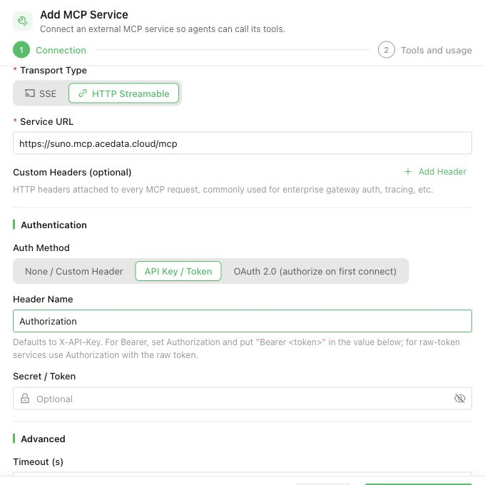
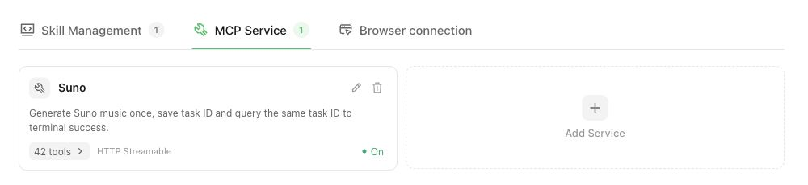
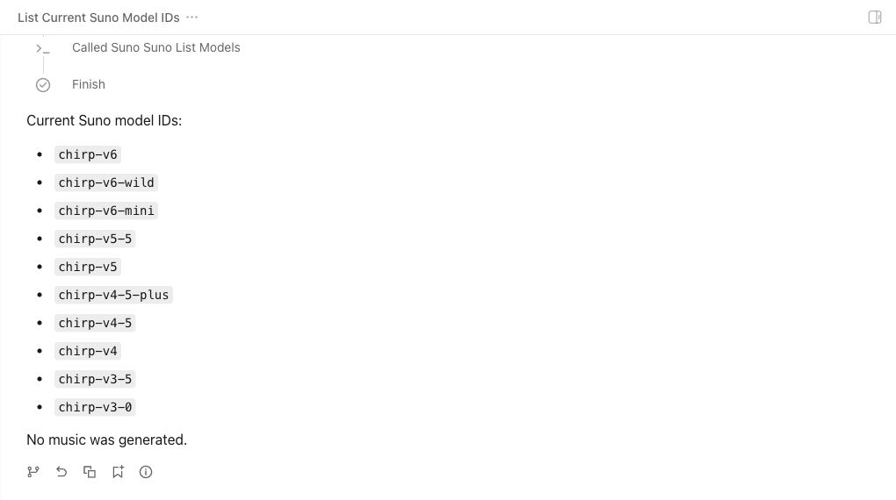
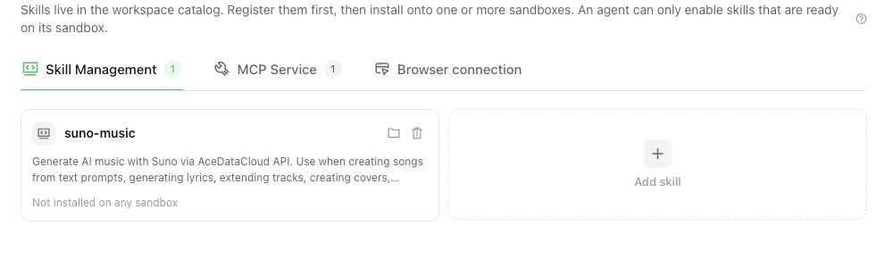
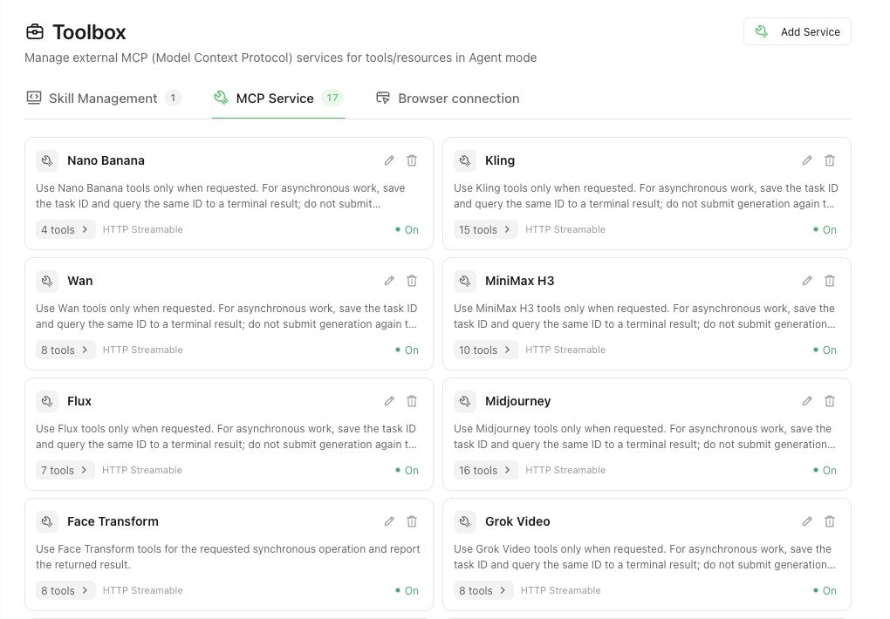
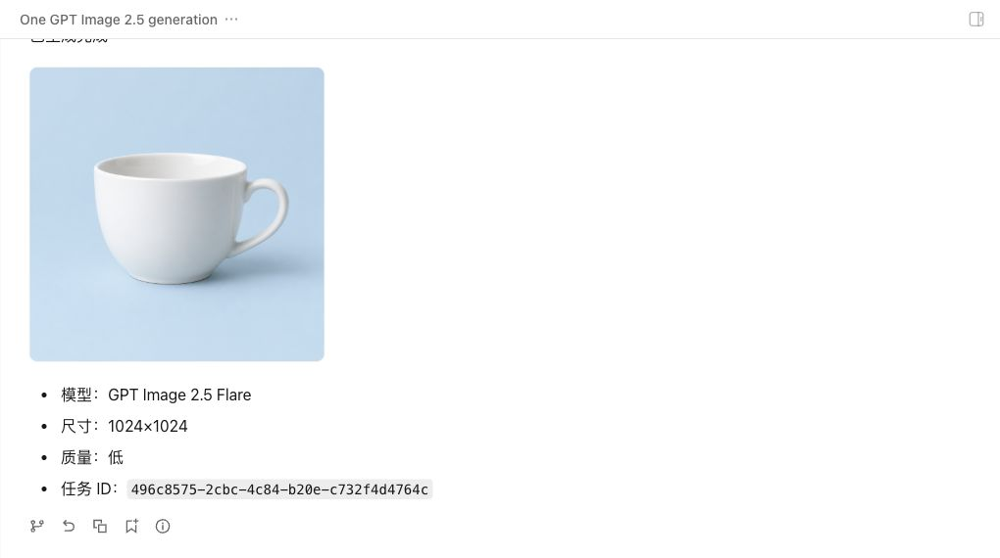
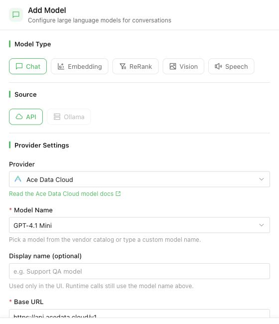

# 在 WeKnora 使用 Ace Data Cloud

[English guide](README.md) · [WeKnora 技能文档](https://weknora.weixin.qq.com/docs/03-features/22-skills-sandbox) · [WeKnora MCP 文档](https://weknora.weixin.qq.com/docs/03-features/08-mcp)

本指南以 2026-10-11 查询到的最新稳定版 **WeKnora v0.8.2** 为准。WeKnora 能从 ClawHub、SkillHub、Git、ZIP 导入公开技能，也能连接 Streamable HTTP MCP 服务。已发布的 v0.8.2「工具箱」没有远端市场搜索，实测也没有服务列表搜索框；后续开发构建只增加对本空间已登记条目的过滤，仍不搜索远端目录。首次真实调用建议使用下方已托管的 Suno MCP。Skill 提供操作说明，MCP 提供可调用的工具。

**Lite v0.8.2 注意事项：** 该版 SQLite 迁移缺少 MCP 元数据 schema，添加服务可能报 `table mcp_services has no column named usage_instructions`（[上游 Issue #4058](https://github.com/Tencent/WeKnora/issues/4058)）。修复 [#4060](https://github.com/Tencent/WeKnora/pull/4060) 已合入 `main`，但不在 v0.8.2 发行版里。Lite 正常使用应选择包含该迁移的正式版本；不要照本教程手改生产数据库。独立稳定版源码实验仅在一次性 SQLite 测试库补入上游迁移，之后 Agent 成功执行免费的 `suno_list_models`。

## 1. 获取 Ace Data Cloud Key

1. 登录 [Ace Data Cloud 控制台](https://platform.acedata.cloud/console/applications)，开通 **Suno** 服务，创建有 Suno 权限的凭据。如果还要在 WeKnora 配置聊天模型，凭据也需要 **AI Chat** 权限。
2. 生成前查看 [Suno 当前价格](https://platform.acedata.cloud/services/suno?tab=pricing)和可用 Credits。生成会计费；任务查询是独立的读取操作。
3. 只在 WeKnora 的凭据输入框填写 Key。不要将 Key 写入对话、示例 JSON、截图或 Git 提交。

## 2. 导入 Suno MCP 服务

1. 在 WeKnora 打开 **工具箱 → MCP 服务 → 添加服务**。选择**从代码导入**，粘贴不含密钥的 [suno.mcp.json](suno.mcp.json)；也可以手动填写名称 `Suno`、URL `https://suno.mcp.acedata.cloud/mcp`，传输方式选 **Streamable HTTP**。
2. 认证选 **Bearer Token**；如果当前界面显示 **API Key / Token**，把 Header 名称填为 `Authorization`，凭据值填 `Bearer <你的 Ace Key>`。不要放进普通自定义 Header。
3. 保存并运行**测试连接**，同步工具，确认有 `suno_generate_music`、`suno_get_task` 和 `suno_list_models`。只启用需要的工具；如果空间要求生成操作先审批，为生成工具打开调用审批。
4. 在 Agent 编辑页启用 MCP，选中 Suno 服务并保存，然后新建**智能推理**对话。仅保存服务而未让 Agent 选中时，对话不能使用它。

截图来自真实 v0.8.2 英文前端和仅在隔离测试库补入上游迁移 #4060 的 SQLite 实例；图中没有 Key。

托管端点要求 Bearer 凭据：未授权请求返回 401。2026-10-11 使用有权限的 Ace Key 实测 MCP `initialize`、`tools/list` 成功，`suno_list_models` 返回当前模型列表。这证明连接和工具发现，尚不代表付费歌曲已经生成完成。

## 3. 生成并查询同一首歌

在 Agent 对话中输入：

> 使用 Suno MCP 创建一首描写安静清晨的短篇纯音乐。先用 `suno_list_models` 确认模型，只调用一次 `suno_generate_music`；保存返回的 `task_id`，随后一直用同一个 ID 调 `suno_get_task`，直到 `state` 为 `complete` 且 `success` 为 true。最后给出音频 URL 和任务 ID。等待期间不要再次提交生成。

生成工具很快返回任务 ID。`pending` 或 HTTP 200 只说明任务已受理，并非音频完成。超时或中断后继续查询**同一个**任务 ID。拿到终态音频 URL 后打开并确认可以播放。在 Ace Data Cloud 控制台核对这一次生成对应的用量记录和扣除 Credits；若需换算 USD，应读取当前套餐汇率。

如果已有旧任务只想查询结果，让 Agent 用保存的 ID 调 `suno_get_task` 即可；这不会再提交一次付费生成。

此截图是补入迁移后的稳定版源码实例调用**免费** `suno_list_models` 的结果，未再次生成歌曲。

### 真实验收样例（2026-10-11）

隔离的 WeKnora Lite 本地构建接入 Ace 模型 Provider 分支和 Suno MCP，对 `suno_generate_music` 开启单次审批，只提交了 **1 次** `chirp-v6-mini` 纯音乐生成。返回任务 ID `938109ac-c2b8-4cdd-9c0d-2bf8cf66b4be`。之后 WeKnora Agent 用**同一个 ID** 调 `suno_get_task`，拿到 `state=complete`、`response.success=true` 与两条 `succeeded` 结果：[音频 1](https://cdn.acedata2.cloud/suno/1afac1aa-c215-4f54-a899-7c2a8ee6ea37.mp3)、[音频 2](https://cdn.acedata2.cloud/suno/9b2813f0-03ac-44bb-ba38-cc00a5513f93.mp3)。两个 URL 的 HTTP HEAD 均为 200、`audio/mpeg`。同 trace 的 Ace 调用流水显示原价 **0.56 Credits**，测试账户实际扣除 **0.504 Credits**。浏览器播放未验证。这是本地开发构建验收，不等于稳定版或市场上架。

## 4. 需要操作说明时安装 Skill

空间 Admin/Owner 可以打开 **工具箱 → 技能管理 → 添加技能**，粘贴公开来源 `https://github.com/AceDataCloud/Skills/tree/main/skills/suno-music`。选定已配置的沙箱，等待安装状态变为**就绪**。如果 Skill 会执行 Shell 命令，私下配置它声明的 `ACEDATACLOUD_API_TOKEN`。然后在 Agent 编辑页选择对应 Skill 和沙箱。添加到目录不等于安装到沙箱；安装 Skill 也不会自动增加 MCP 工具。

可以在 [skills.sh 搜索 Suno](https://www.skills.sh/search?q=suno)，看到 `acedatacloud/skills` 条目和安装命令。但 v0.8.2 将 **skills.sh 页面 URL** 粘贴到 WeKnora 时，会因解析器要求 ClawHub 联合收录副本而报 `Skill not found`（[上游 Issue #4167](https://github.com/Tencent/WeKnora/issues/4167)）。请改用上面的 GitHub Skill 目录 URL；隔离稳定版源码实验已将其登记为 `suno-music`。这是手动来源导入，不等于产品内市场搜索或沙箱安装完成。

WeKnora 也能解析 ClawHub/SkillHub 页面和 slug，但外部条目可能晚于 [Ace Skills 源码](https://github.com/AceDataCloud/Skills)。安装前检查内容与版本。当前稳定版工具箱没有远端市场搜索，粘贴来源仍属手动安装路径。

## 5. 其他按服务名称查找的入口

下表每项都可用同一种 Git Skill 来源格式，把 `suno-music` 替换为对应 Skill ID。各 `SKILL.md` 说明其操作和任务查询契约。已公开的托管 MCP 地址见 [MCP 对照表](../../skills/_shared/mcp-servers.md)；在 **工具箱 → MCP 服务**连接后，用私密 Bearer 凭据并只启用所需工具。需要实际核对该服务的工具清单和终态产物，才能称为在 WeKnora 运行成功。

| 服务搜索词 | Skill ID |
| --- | --- |
| Suno | [suno-music](../../skills/suno-music/SKILL.md) |
| GPT Image | [gpt-image-2-5](../../skills/gpt-image-2-5/SKILL.md) |
| Seedance | [seedance-video](../../skills/seedance-video/SKILL.md) |
| Fish Audio | [fish-audio](../../skills/fish-audio/SKILL.md) |
| Seedream | [seedream-image](../../skills/seedream-image/SKILL.md) |
| Happy Horse | [happyhorse-video](../../skills/happyhorse-video/SKILL.md) |
| Qwen Image | [qwen-image](../../skills/qwen-image/SKILL.md) |
| Veo | [veo-video](../../skills/veo-video/SKILL.md) |
| Google Search | [google-search](../../skills/google-search/SKILL.md) |
| Grok Video | [grok-video](../../skills/grok-video/SKILL.md) |
| Face Transform | [face-transform](../../skills/face-transform/SKILL.md) |
| Midjourney | [midjourney-image](../../skills/midjourney-image/SKILL.md) |
| Flux | [flux-image](../../skills/flux-image/SKILL.md) |
| MiniMax H3 | [minimax-video](../../skills/minimax-video/SKILL.md) |
| Wan | [wan-video](../../skills/wan-video/SKILL.md) |
| Kling | [kling-video](../../skills/kling-video/SKILL.md) |
| Nano Banana | [nano-banana-image](../../skills/nano-banana-image/SKILL.md) |

17 张服务卡片各自经过 WeKnora 后端连接测试和工具目录同步；仅在一次性 SQLite 测试库补入上游迁移。这是本空间**已配置的列表**，并非远端市场。卡片使用 WeKnora 的通用工具图标，没有服务专属 Logo；工具同步成功不表示每项付费生成都得到终态。

### GPT Image 2.5 真实验收样例（2026-10-12）

使用具有 GPT Image 权限的凭据并先核对[图片 API 当前价格](https://platform.acedata.cloud/api/v1/apis/?path=%2Fopenai%2Fimages%2Fgenerations)后，同一隔离 v0.8.2 补库实例的 Agent 选中了 **GPT Image** MCP。只启用图片生成、任务查询、模型列表三个工具，对生成实行单次审批。唯一一次 `openai_generate_image` 使用 `gpt-image-2.5-flare`、`1024x1024`、`quality=low`、`n=1`、`async=true`。Agent 用任务 ID `496c8575-2cbc-4c84-b20e-c732f4d4764c` 查询两次：第一次 pending，第二次有 `finished_at` 且 `response.success=true`。[最终图片](https://cdn.acedata2.cloud/gpt-image/a8aee29222a3b4e2c4dcb7c3ad585d00ef57359b456efc1dbf177b19da19f40e.png) 已在浏览器打开为 1024×1024，白色陶瓷杯符合提示词。账单精确匹配 1 条记录：原价 **0.19 Credits**，实际扣 **0.171 Credits**。没有再次提交图片生成。

这证明补库稳定版测试实例的 GPT Image 手动 MCP 路径，不代表 WeKnora 市场可发现、未经修补的 Lite v0.8.2 可用，也不代表其余 15 项的主流程已验收。

当前 v0.8.2 要添加聊天模型，请选 **设置 → 模型 → 添加模型 → 对话 → API → 自定义（OpenAI 兼容接口）**，Base URL 为 `https://api.acedata.cloud/v1`，模型 ID 选公开支持的聊天模型，例如 `gpt-4.1-mini`，填写具有 AI Chat 权限的 Ace Key，先**测试连接**再保存。Ace Data Cloud 命名 Provider 的[上游 PR 仍在审核](https://github.com/Tencent/WeKnora/pull/4163)；源码和 CI 不等于稳定版已内置。

预览由 v0.8.2 前端连接该 PR 的开发后端得到；图标使用 Ace 原始 PNG。未经修改的稳定版后端还没有这个选项。

## 排障

- **添加前无法搜索 Suno**：v0.8.2 工具箱没有远端市场搜索，实测稳定版界面也没有服务列表搜索框。请直接添加 MCP URL 或 Git Skill 来源。后续开发构建只能过滤本空间已登记条目。
- **401 / 403**：检查已保存凭据是否按 `Authorization: Bearer` 发送，以及 Suno 权限。403 也可能是内容审核，应读取具体错误消息。
- **429**：按返回的限速时间等待。**5xx 或连接中断**：保留原 `task_id`，先查询它，不要直接再生成。
- **工具已同步但 Agent 不调用**：确认 Agent 使用智能推理、已启用 MCP、选中 Suno、相应工具处于启用状态。
- **只有任务 ID，没有可播放音频**：继续查到 `state=complete` 且 `success=true`，检查最终 URL 并打开验证。任务 ID 不能当成交付产物。
- **Skill 不可用**：检查沙箱安装是否就绪，以及 Agent 选择的沙箱与技能范围。沙箱重建期间可能短暂不可用。
- **skills.sh 页面报 `Skill not found`**：使用第 4 步的 GitHub Skill 目录地址。当前 WeKnora 的 skills.sh 解析器只覆盖被 ClawHub 联合收录的条目；其余缺口见 [#4167](https://github.com/Tencent/WeKnora/issues/4167)。
